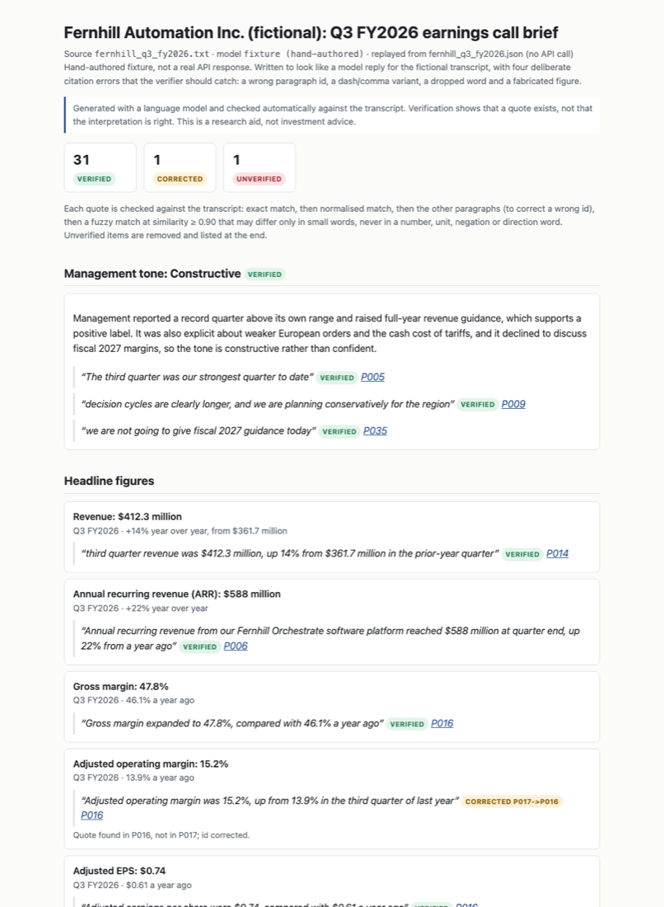

# earnings-call-analyzer

Turns an earnings call transcript into a structured analyst brief with Claude, where every claim carries a verbatim quote that is automatically checked against the transcript.

[](https://github.com/robinrhs/earnings-call-analyzer/actions/workflows/ci.yml)




*The HTML report for the fictional example call, rendered headlessly from [`examples/output/fernhill_q3_fy2026.brief.html`](examples/output/fernhill_q3_fy2026.brief.html).*

## What and why

After an earnings call an analyst writes down the same things every quarter: the reported figures, the guidance and whether it changed, how management sounded, which risks came up, and what the analysts pushed on in the Q&A. A language model can draft that brief in a minute. The problem is that it can also write a fluent brief that contains a number nobody said.

This tool lets the model do the reading and checks the result mechanically:

1. The transcript is split into numbered paragraphs (`P001`, `P002`, ...) tagged with speaker, role and section (prepared remarks or Q&A).
2. Claude returns the brief as JSON in a fixed schema. **Every item must cite a paragraph id and a verbatim quote.**
3. Every quote is checked against the transcript. Items are marked **verified**, **corrected** (right words, wrong paragraph id) or **unverified**. Unverified items are removed from the brief by default and listed separately.
4. Two briefs can be compared quarter over quarter: guidance raised, lowered or maintained, new and dropped risks, tone shift.
5. Output: Markdown and a self-contained HTML report with verification badges, where every cited id links to the paragraph.

It is a research aid for reading calls faster and with an audit trail. It is not investment advice and does not produce recommendations.

## Quickstart

```bash
git clone https://github.com/robinrhs/earnings-call-analyzer.git
cd earnings-call-analyzer
uv sync

# Runs without an API key: replays a recorded model response (see "About the example")
uv run python -m earnings_call_analyzer analyze examples/fernhill_q3_fy2026.txt \
    --replay examples/replay/fernhill_q3_fy2026.json

# Quarter-over-quarter comparison of the two fictional calls
uv run python -m earnings_call_analyzer compare \
    examples/fernhill_q2_fy2026.txt examples/fernhill_q3_fy2026.txt \
    --replay examples/replay/fernhill_q2_fy2026.json examples/replay/fernhill_q3_fy2026.json
```

With your own transcript and an Anthropic API key:

```bash
export ANTHROPIC_API_KEY=...                     # read from the environment only, never stored
# (or fill in a copy of .env.example as .env and run: set -a; source .env; set +a)
uv run python -m earnings_call_analyzer paragraphs my_call.pdf          # check the parsing first
uv run python -m earnings_call_analyzer analyze my_call.pdf --dry-run   # token and cost estimate
uv run python -m earnings_call_analyzer analyze my_call.pdf --record my_call.replay.json
```

Reports are written to `reports/` (git-ignored) as `.md`, `.html` and `.json`.

| Option | Default | Meaning |
|---|---|---|
| `--model` | `$ECA_MODEL` or `claude-opus-5-5` | Claude model id |
| `--effort` | `high` | How much reasoning the model spends (`low` ... `max`) |
| `--unverified` | `drop` | `drop`: remove unverified items (listed under "Rejected"); `flag`: keep them with a red badge |
| `--fuzzy-threshold` | `0.90` | Minimum similarity for a near-verbatim match |
| `--replay FILE` / `--record FILE` | | Use / save a model response instead of / after calling the API (`compare` takes two files) |
| `--format` | `md html json` | Which report formats to write |

Put real transcripts in a local `transcripts/` folder; it is git-ignored. Transcripts from data providers are usually copyrighted, so do not commit them.

## Example output

The repository contains one fictional company, **Fernhill Automation Inc.**, with a Q3 FY2026 call that I wrote for this project (prepared remarks and Q&A, about 2,100 words) and a shorter Q2 FY2026 call (about 1,000 words). The Q2 call exists only because the quarter-over-quarter mode needs a prior quarter to compare against. All names, figures and firms are invented.

### About the example

The example reports were **not** produced by a live API call. I do not commit API keys, and a real model response would change from run to run. Instead, `examples/replay/*.json` are **hand-authored fixtures** in the same format the tool records from the API. The Q3 fixture contains four deliberate citation errors of the kind language models make, so you can see the verifier work:

| Planted error | What the verifier did |
|---|---|
| Correct quote, wrong paragraph id (P017 instead of P016) | Found the quote in P016, marked **corrected** |
| Comma replaced by a dash | Matched after normalisation, marked **verified (normalized)** |
| One word dropped ("that projects" vs "that the projects") | Fuzzy match 0.98, marked **verified (fuzzy)**, shows the transcript wording |
| Invented figure ("Net revenue retention 118%"), not in the Q3 call | Not found anywhere, **unverified**, removed from the brief |

Running the first quickstart command prints (real output):

```text
Parsed 46 paragraphs from fernhill_q3_fy2026.txt: 20 prepared remarks, 24 Q&A, 2 front matter.
Brief: fixture (hand-authored), replayed from fernhill_q3_fy2026.json (no API call)
Quotes checked: 33 | verified 31 | corrected 1 | unverified 1
  rejected: Headline figures: Net revenue retention (software): 118%
```

Excerpt from [`examples/output/fernhill_q3_fy2026.brief.md`](examples/output/fernhill_q3_fy2026.brief.md):

```markdown
- **Adjusted operating margin: 15.2%** (13.9% a year ago), Q3 FY2026
  `CORRECTED P017->P016` P016: "Adjusted operating margin was 15.2%, up from 13.9% in the third quarter of last year"
    Quote found in P016, not in P017; id corrected.

### European demand - Marcus Oyelaran (Ridgefield Partners), answer: partial
- Answer: Described as a delay, not a shift; Q4 assumes European orders stay at Q3 levels; management would not call the bottom.
  `VERIFIED (fuzzy 0.98)` P030: "What we hear from customers is that projects are still on their roadmaps, but boards are asking for more certainty"
    Transcript reads: "What we hear from customers is that the projects are still on their roadmaps, but boards are asking for more certainty"

## Rejected by verification
- Headline figures: Net revenue retention (software): 118%
  - Cited P006. Quote not found in the transcript. Closest passage: P017 (similarity 0.61).
```

Excerpt from the quarter-over-quarter report [`examples/output/fernhill_q2_fy2026_vs_fernhill_q3_fy2026.compare.md`](examples/output/fernhill_q2_fy2026_vs_fernhill_q3_fy2026.compare.md):

| Metric | Period | Previous | Current | Change | Detail |
|---|---|---|---|---|---|
| Revenue | FY2026 | $1.58 billion to $1.63 billion | $1.62 billion to $1.66 billion | **raised** | Midpoint 1,605 -> 1,640 million (+35 million, +2.2%). |
| Adjusted operating margin | FY2026 | approximately 15% | approximately 15% | **maintained** | Midpoint unchanged. |
| Free cash flow | FY2026 | $140 million to $155 million | $120 million to $135 million | **lowered** | Midpoint 147.5 -> 127.5 million (-20 million, -13.6%). |
| Revenue | Q4 FY2026 | - | $435 million to $450 million | **new** | No comparable guidance last quarter. |
| Revenue | Q3 FY2026 | $400 million to $415 million | - | **reported** | Reported $412.3 million, within the guided range (upper half) of $400 million to $415 million. |

Tone: 1 notch more positive: balanced -> constructive. Risks: Europe demand and tariffs are new; supply chain, pricing and customer concentration persist, each marked "matched on category only" because the titles differ between the two calls; technician wage inflation was dropped. The example has no "Not compared" section because every guidance item and figure in it passed the checks.

All example reports: [`examples/output/`](examples/output/) (open the `.html` files in a browser).

## Why quote verification matters

* **Hallucinated numbers are the expensive failure.** A made-up guidance range or margin reads exactly like a real one. Requiring a quote turns "trust the model" into "check the transcript", and a program can do the checking.
* **The model is good at reading, bad at bookkeeping.** In practice the words are usually right and the paragraph id is sometimes off, or a quote is copied with a typographic difference. Those cases are repaired (corrected id, normalised match) instead of being thrown away, and the report says so.
* **The reader can audit every line.** In the HTML report each id links to the paragraph; fuzzy matches show the transcript's actual wording next to the model's quote.
* **What verification does not do:** it proves a quote exists, not that the model's summary or label is a fair reading of it. That judgement stays with the reader.

## Method

### 1. Parsing (`transcript.py`)

Text is split on blank lines; hard-wrapped lines inside a paragraph are joined. Speakers are recognised in three layouts: `Name -- Title` on its own line, `Name: text` inline, and a bare name line. To avoid mistaking prose for a speaker, a name is trusted when it appears in the participants list, is introduced by the operator ("our next question comes from ..."), is used as a speaker label at least twice, or is mentioned elsewhere in the text. Roles come from the participants list and title keywords (CEO, CFO, Head of IR -> management; analyst firms -> analyst); speakers in the prepared remarks default to management. The Q&A starts at an explicit header ("Question-and-Answer Session") or, if there is none, at the operator paragraph that opens the line for questions. For PDFs (via `pypdf`), page-number lines are removed and hyphenated line breaks re-joined.

### 2. Extraction (`llm.py`, `prompt.py`, `schema.py`)

The transcript is sent as `[P012] Speaker (role, section): text` lines. The request uses Claude's structured outputs (`output_config.format` with the JSON schema of the Pydantic `Brief` model), and the reply is validated again with Pydantic. Unknown keys are rejected. The default model is `claude-opus-5-5` with `effort: high`; server-side fallback (`fallbacks: "default"`) retries a declined request on a fallback model.

Schema (every item has `evidence: {paragraph_id, quote}`):

| Section | Fields |
|---|---|
| `headline_figures` | metric, value, period, comparison |
| `guidance` | metric, period, current, prior (only if stated on the call), direction: raised / lowered / maintained / initiated / withdrawn / not_stated |
| `tone` | label: defensive / cautious / balanced / constructive / confident, justification, 2-3 quotes |
| `risks` | title, category (fixed list, e.g. demand, pricing_competition, costs_supply_chain), description |
| `analyst_questions` | analyst, firm, topic, question and answer summary, answer quality: direct / partial / deflected, one quote each for question and answer |

### 3. Verification (`verify.py`)

For each quote, strictest test first:

1. **Exact**: the quote is a substring of the cited paragraph that starts and ends on a word or number boundary. "9% to $82 million" is *not* found in "grew 19% to $82 million", and "3% as orders slowed" is not found in "-3% as orders slowed".
2. **Normalised**: same word sequence after Unicode NFKC, curly quotes -> straight, en/em dashes and minus -> hyphen, lower-casing, and stripping punctuation at word edges. `$`, `%` and a minus sign in front of a number are kept because they change meaning, and accounting brackets are read as a minus ("(3)%" -> "-3%"). Matching is on whole words, so "rev" never matches "revenue".
3. **Other paragraphs**: steps 1-2 on every other paragraph, nearest to the cited one first. A hit means the id was wrong: status **corrected**.
4. **Fuzzy** (cited paragraph first, then the others): the best similarity between the normalised quote $q$ and any window $w$ of the paragraph that is 2 words shorter to 2 words longer than the quote, using Python's `difflib.SequenceMatcher`:

$$\text{similarity}(q, w) = \frac{2M}{|q| + |w|}$$

   where $M$ is the number of matching characters and $|q|, |w|$ are the string lengths. Accepted if similarity $\ge 0.90$, the quote has at least 8 words, **and none of the words that differ changes the claim**. The differing words are found with a word-level diff; the match is rejected if any of them contains a digit, `$` or `%`, is a unit or scale word (million, billion, bps, ...), a negation (not, no, never, ...n't) or a direction word (up/down, higher/lower, rose/fell, ...). Each of these is more than 90% similar as a string and still a different statement:

   Against the transcript sentence "We now expect full-year revenue of $1.62 billion to $1.66 billion, and we do not expect further margin pressure next year" (measured with `check_quote`; the same cases are regression tests in `tests/test_verify.py`):

   | Quote from the model | Similarity | Result |
   |---|---|---|
   | We now expect full-year revenue of **$1.70** billion to $1.66 billion | 0.97 | rejected: `'$1.70' vs '$1.62'` |
   | We now expect full-year revenue of $1.62 **million** to $1.66 **million** | 0.97 | rejected: `'million' vs 'billion'` (1,000x) |
   | and we do expect further margin pressure next year | 0.96 | rejected: `'(nothing)' vs 'not'` |

   The rejection note names the difference, as in the last column.
5. Otherwise **unverified**; the note names the closest passage and its similarity.

Quotes shorter than 5 words are never accepted (too easy to find by chance). An item with several quotes takes its weakest status. Two further checks produce warnings: numbers in a figure's `value` or a guidance range that do not appear in the source paragraph, and analyst-question quotes that come from the wrong speaker or role. The number check reads amounts with sign, unit and currency (`amounts.py`), ignores period labels and years ("Q4", "fiscal 2026"), accepts the same amount in another scale ("$1,620 million" for "$1.62 billion"), and accepts "-3%" when the paragraph says "a decline of 3%".

### 4. Quarter-over-quarter (`compare.py`)

Only items that are verified or corrected **and** carry no number warning are compared. A real quote next to a guidance range the model typed wrongly must not produce a "raised" call, so such items are left out, listed under **Not compared** in the report, and their counterpart in the other call shows as `not_compared` instead of `new` or `dropped`.

Guidance is matched on metric and period (`FY2026`, `fiscal 2026` -> `FY 2026`; `Q4 FY2026`, `fourth quarter` -> `Q4 2026`; `H2 FY2026`, `second half` -> `H2 2026`; `calendar 2026` -> `CY 2026`). Two items with the same key in one call produce a warning; only the first is compared.

The guided range is read from the guidance text: the first amount with a unit or currency, plus the next amount if only "to", "-", "and" or "through" stands between them ("$1.62 to $1.66 billion": the first end takes the unit of the second). Years and period labels are never part of the range. The range is negative if it has a minus sign or accounting brackets, or if the metric or the words before it say loss or decline ("an operating loss of $20 million to $10 million" -> -20 to -10, so a wider loss next quarter reads as *lowered*). Money with a scale word is converted to millions, then the midpoints are compared:

$$\text{midpoint} = \frac{\text{low} + \text{high}}{2}, \qquad \Delta = \text{mid}_\text{new} - \text{mid}_\text{old}, \qquad \text{relative change} = \frac{\Delta}{\text{mid}_\text{old}}\ (\text{only if } \text{mid}_\text{old} > 0)$$

The guidance counts as maintained if $|\Delta| \le 0.5\% \times \max(|\text{mid}_\text{old}|, |\text{mid}_\text{new}|)$; using the larger midpoint keeps the rule meaningful when the old midpoint is 0. Percentages are compared in percentage points, bps in bps, multiples (2.5x) as multiples, and per-share amounts in currency ("$2.15 -> $2.35"), never as "million". If the rest of the wording contains other figures that changed, the detail says so.

If last quarter guided the quarter that was just reported, the actual figure is placed against that range (above, upper half, lower half, below). Risks are matched by category; within a category the titles with the most words in common are paired, and a pair that shares less than 30% of its words is labelled "matched on category only". The tone shift is the difference in rank on the five-step scale, and is only computed if the tone quotes of both calls passed verification.

### 5. Cost per run

Cost = input tokens x input price + output tokens x output price. Output includes the model's reasoning, which is billed as output. `--dry-run` prints an estimate at about 4 characters per token. List prices from Anthropic's pricing table, snapshot dated **2026-10-06** (USD per million tokens):

| Model | Input | Output | Fictional Q3 call (~5,300 input tokens, `--dry-run`) | Typical real call (assumed 15,000 input tokens) |
|---|---|---|---|---|
| `claude-opus-5-5` (default) | $4.00 | $20.00 | $0.10 - $0.26 | $0.14 - $0.30 |
| `claude-sonnet-5-5` | $2.00 | $10.00 | $0.05 - $0.13 | $0.07 - $0.15 |
| `claude-haiku-5-5` | $0.10 | $0.50 | $0.003 - $0.007 | $0.004 - $0.007 |

The ranges assume 4,000 to 12,000 output tokens. These are estimates from `pricing.py`, not measured bills: I have not run the tool against the live API for this README. Check current prices before relying on them; after a real run the report shows the actual token counts returned by the API. If the server-side fallback ran (the first model declined and another one answered), the top-level token counts of the reply cover only the final attempt, so the report sums the per-attempt counts in `usage.iterations` and prices each attempt at the model that ran it. An attempt that declined before producing output is counted too; whether Anthropic bills it is set by their refusal billing rules, so in that case the figure can be slightly high. This fallback path is covered by a test with a mocked reply, not by a live run.

## Key assumptions

* The transcript is in English and roughly follows a standard layout (speaker labels, an operator, prepared remarks followed by Q&A).
* A paragraph (blank-line separated block) is the right unit for citations.
* Management's own description of a guidance change is reported as `direction`; the QoQ diff recomputes the change from the numbers and notes any mismatch.
* A risk category is a stable enough key to match risks across quarters.

## Limitations

* **LLM limits.** The model can miss items, choose weak quotes, or summarise a verified quote unfairly. Tone labels and answer-quality ratings are judgements, not measurements. Verification catches invented quotes, not wrong interpretations.
* **Transcript quality.** Parsing is heuristic. Unusual layouts, PDFs with columns or headers in the text flow, or missing speaker labels lead to wrong speakers or sections; run `paragraphs` first. Very long PDFs may need cleaning.
* **Fuzzy matching is a trade-off.** At 0.90 a quote with one or two changed words still passes if those words are not numbers, units, negations or direction words. The word lists are finite: a swap the lists do not cover ("solid" vs "weak", "expect" vs "doubt") can still pass as VERIFIED (fuzzy), and the report then shows the transcript wording next to the quote so a reader can see it. Quotes with ellipses or merged sentences fail. Raise `--fuzzy-threshold` (or set it to 1.0) for stricter checks.
* **Reading guidance strings is heuristic.** The range is the first amount with a unit; a statement with several figures ("$1.6 billion, up 8% to 10%") is compared on the first one only, with a note if the others changed. A loss or decline is detected from a few words (loss, decline, decrease, down, negative, minus); unusual phrasing such as "a smaller profit" is not recognised.
* **Risk matching across quarters is loose.** Pairing within a category does not prove it is the same risk; the report marks pairs whose titles do not overlap.
* **Numbers in words** ("twelve months") are not compared by the number checks.
* **QoQ comparison** depends on both briefs naming metrics consistently; differently named metrics show up as new and dropped.
* **The example is fictional and the replay files are hand-authored**, so the example shows how verification works, not how well a particular model performs.
* **Not investment advice.** No recommendations, price targets or forecasts.

## Project structure

```text
src/earnings_call_analyzer/
  transcript.py   load .txt/.pdf, paragraph ids, speakers, roles, sections
  schema.py       Pydantic models of the brief (the structured-output schema)
  prompt.py       system prompt and transcript formatting for the model
  llm.py          Anthropic API call, validation, record/replay
  verify.py       quote verification (exact, normalised, id correction, fuzzy) and checks
  amounts.py      read amounts with sign, unit and currency; skip years and period labels
  compare.py      quarter-over-quarter diff of two verified briefs
  report.py       Markdown and HTML rendering (templates/ holds the Jinja2 files)
  pricing.py      price table and cost estimate
  pipeline.py     transcript -> model -> verification -> reports
  cli.py          analyze / compare / paragraphs commands
examples/
  fernhill_q3_fy2026.txt, fernhill_q2_fy2026.txt   fictional transcripts
  replay/                                          hand-authored model responses
  output/                                          generated example reports
docs/report-screenshot.png                         screenshot of the example HTML report
tests/            pytest suite, Anthropic API mocked
```

Development: `uv run pytest`, `uv run ruff check .`, `uv run ruff format --check .`

## License

MIT, see [LICENSE](LICENSE). Copyright (c) 2026 Robin-Philip Rehschuh.
